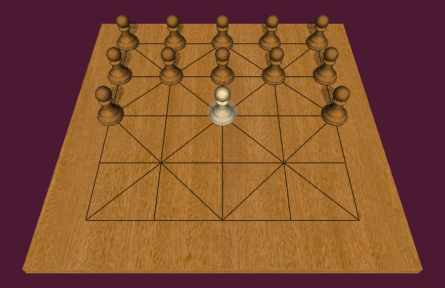

# Catch the Hare 🐇

Jogo de tabuleiro 3D para dois jogadores, inspirado na tradicional **caça à lebre**,
feito em C com OpenGL (pipeline fixo) e GLUT.



## Regras

O tabuleiro tem 5×5 casas ligadas por linhas. Toda casa se liga às vizinhas na
horizontal e na vertical; as casas com `(linha + coluna)` par também têm diagonais.

- **Lebre** (peça clara, começa no centro): anda uma casa por vez ou **salta** sobre
  um caçador adjacente, caindo na casa vazia logo atrás dele, e o captura.
- **Caçadores** (12 peças escuras): andam uma casa por vez e não saltam.
- A lebre começa jogando; os jogadores se alternam a cada jogada.

## Controles

| Ação                         | Tecla / mouse                      |
|------------------------------|------------------------------------|
| Selecionar peça              | clique esquerdo na peça            |
| Mover a peça selecionada     | clique esquerdo na casa de destino |
| Inclinar a câmera            | `W` / `S` ou ↑ / ↓                 |
| Girar a câmera               | `A` / `D` ou ← / →                 |
| Sair                         | `Esc`                              |

## Compilando

Requisitos: compilador C11, [CMake](https://cmake.org) ≥ 3.16, OpenGL e
[freeglut](https://freeglut.sourceforge.net/).

### Linux (Debian/Ubuntu)

```bash
sudo apt install build-essential cmake freeglut3-dev
```

```bash
cmake -S . -B build
```

```bash
cmake --build build
```

```bash
./build/catch-the-hare
```

### Windows

Com [vcpkg](https://vcpkg.io):

```bash
vcpkg install freeglut
```

```bash
cmake -S . -B build -DCMAKE_TOOLCHAIN_FILE=<vcpkg>/scripts/buildsystems/vcpkg.cmake
```

```bash
cmake --build build --config Release
```

Ou com [MSYS2](https://www.msys2.org) (`pacman -S mingw-w64-ucrt-x86_64-freeglut`).

### macOS

O GLUT do sistema é usado automaticamente (está obsoleto, mas funciona):

```bash
cmake -S . -B build && cmake --build build
```

### Testes

As regras do jogo ficam num módulo sem dependência de OpenGL e têm testes unitários:

```bash
ctest --test-dir build --output-on-failure
```

Para compilar só os testes (sem precisar de OpenGL): `cmake -S . -B build -DCTH_BUILD_GAME=OFF`.

### Recursos (modelos e texturas)

O executável procura a pasta `assets/` nesta ordem: variável de ambiente
`CTH_ASSETS_DIR`, `./assets` no diretório atual, a pasta do código-fonte e a
pasta de instalação (`cmake --install build`).

## Estrutura do projeto

```
.
├── CMakeLists.txt
├── src/
│   ├── main.c            ponto de entrada
│   ├── jogo.c/.h         laço do jogo: estado, câmera, entrada, renderização, animações
│   ├── regras.c/.h       regras do jogo (puro C, sem OpenGL, testável)
│   ├── tabuleiro.c/.h    peças, posições no tabuleiro e desenho
│   ├── modelo.c/.h       leitor de .obj compilado em display lists
│   ├── recursos.c/.h     localização dos assets e carregamento de texturas
│   ├── util.c/.h         matemática: sombras planares, rotação da luz, arco do salto
│   └── plataforma_gl.h   includes de OpenGL/GLUT por plataforma
├── tests/                testes unitários das regras
├── third_party/tga/      carregador de TGA (David Henry, licença MIT)
├── assets/
│   ├── models/           peca.obj, tabuleiro.obj
│   └── textures/         texturas .tga
├── art/                  arquivos-fonte do Blender
└── docs/                 imagens do README
```

## Créditos

- Carregador de texturas TGA: David Henry (2005), licença MIT — ver
  [`third_party/tga/tga.c`](third_party/tga/tga.c).
